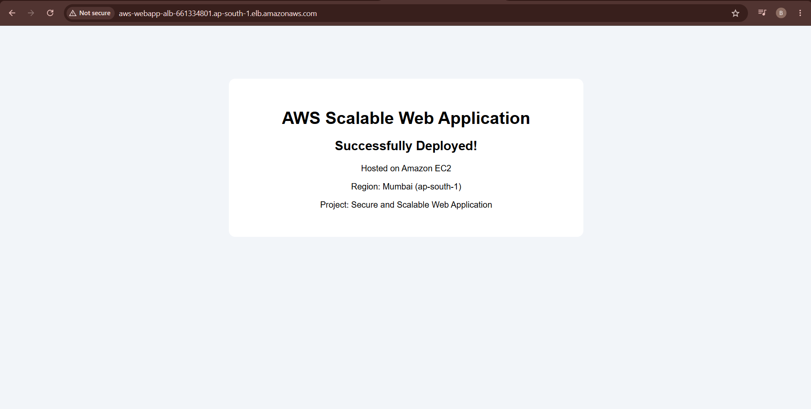
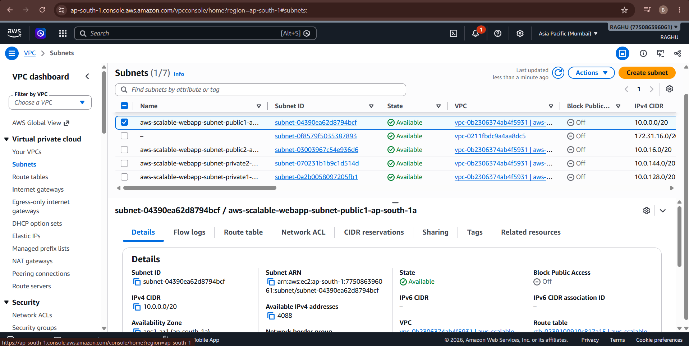
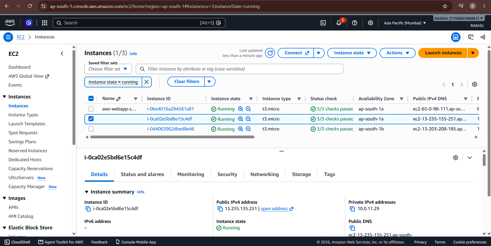
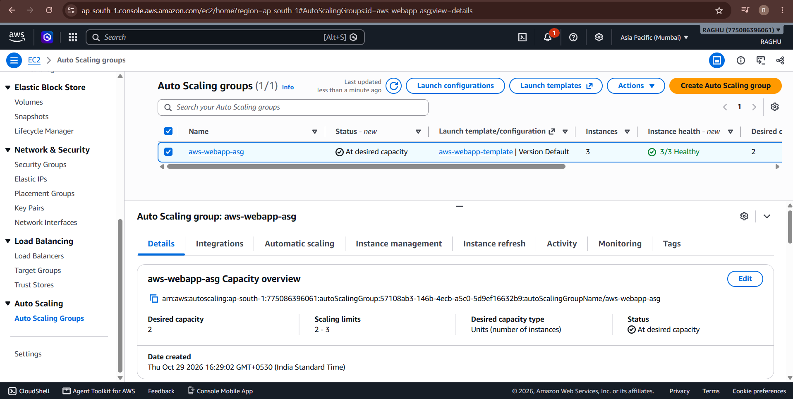
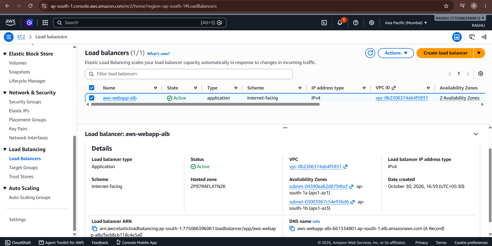
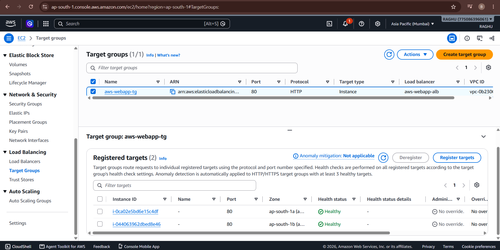
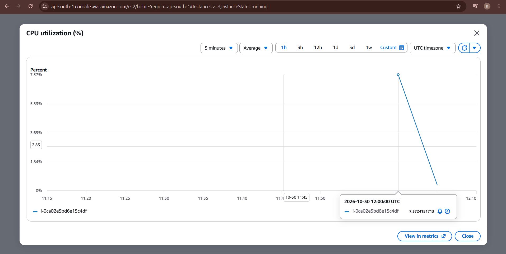
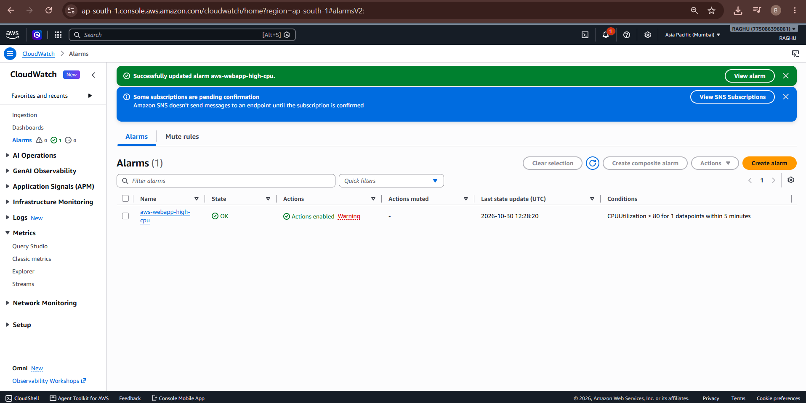
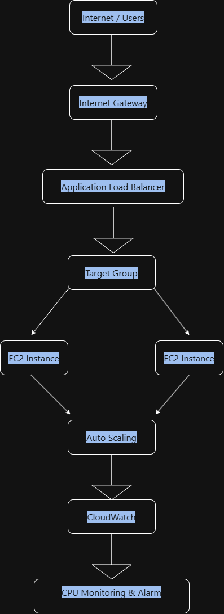

# AWS-Scalable-Webapp
Secure and Scalable Web Application Deployment on AWS using EC2, VPC, Application Load Balancer, Auto Scaling, and CloudWatch.
# Secure and Scalable Web Application Deployment on AWS

A cloud infrastructure project demonstrating how to deploy a web application on AWS using Amazon EC2, a Virtual Private Cloud (VPC), an Application Load Balancer, EC2 Auto Scaling, and Amazon CloudWatch.

## 📌 Project Overview

The objective of this project was to deploy a web application on AWS and explore the essential components used to build a scalable, monitored, and secure cloud environment.

I configured the network, deployed a web server, connected an Application Load Balancer, configured an Auto Scaling Group, and set up CloudWatch monitoring and an alarm for CPU utilization.

## 🎯 Project Objectives

- Deploy a web application using Amazon EC2.
- Configure a VPC and subnets for network organization.
- Route incoming HTTP traffic through an Application Load Balancer.
- Configure an Auto Scaling Group to manage EC2 instance capacity.
- Monitor EC2 CPU utilization using Amazon CloudWatch.
- Configure an alarm to detect high CPU utilization.
- Apply security group rules to control network access.
- Understand AWS resource management and cost optimization.

## 🏗️ Architecture

The project uses the following AWS components:

- **Amazon VPC:** Provides the network environment.
- **Public and private subnets:** Organize network resources.
- **Internet Gateway:** Provides internet connectivity for resources using the public route.
- **Amazon EC2:** Hosts the Apache web server and application page.
- **Application Load Balancer:** Receives HTTP requests and forwards traffic to registered targets.
- **Target Group:** Registers EC2 instances and checks their health.
- **EC2 Auto Scaling:** Manages the number of instances according to the configured capacity.
- **Amazon CloudWatch:** Monitors CPU utilization and evaluates alarm conditions.
- **Security Groups:** Control inbound and outbound network traffic.

### Architecture Diagram

```text
                  Internet / Users
                         |
                         v
                  Internet Gateway
                         |
                         v
               Application Load Balancer
                         |
                         v
                    Target Group
                         |
              +----------+----------+
              |                     |
              v                     v
          Amazon EC2            Amazon EC2
          Web Server            Web Server
              ^                     ^
              |                     |
              +----------+----------+
                         |
                  EC2 Auto Scaling
                  Group Management

              Amazon CloudWatch
              CPU Monitoring
              Alarm Configuration

        All resources are organized within
        the AWS VPC and subnet environment.
```

*Note: The diagram illustrates the intended traffic flow and resource relationships. Refer to the screenshots for the configuration that was actually deployed.*

## 🛠️ AWS Services and Technologies

| Service | Purpose |
|---|---|
| Amazon VPC | Network configuration |
| Public and private subnets | Network segmentation |
| Internet Gateway | Internet connectivity |
| Amazon EC2 | Web application hosting |
| Application Load Balancer | HTTP traffic distribution |
| Target Groups | Target registration and health checks |
| EC2 Auto Scaling | Instance capacity management |
| Amazon CloudWatch | Monitoring and alarms |
| Security Groups | Network access control |
| Apache HTTP Server | Serving the web page |

## ⚙️ Implementation Steps

### 1. Network Configuration

- Created a custom VPC named `aws-scalable-webapp`.
- Configured public and private subnets.
- Attached an Internet Gateway.
- Configured a public route for internet connectivity.
- Created security groups to control access to the web application.

### 2. EC2 Web Server Deployment

- Created an EC2 launch template named `aws-webapp-template`.
- Used Amazon Linux 2023 as the operating system.
- Configured Apache HTTP Server using user data.
- Deployed a sample web page displaying the project information.
- Verified that the web page was accessible.

### 3. Application Load Balancer

- Created an internet-facing Application Load Balancer named `aws-webapp-alb`.
- Configured an HTTP listener on port 80.
- Forwarded incoming requests to the target group `aws-webapp-tg`.
- Verified that the application was accessible through the load balancer's DNS name.

### 4. Target Group and Health Checks

- Created a target group for the EC2 web servers.
- Configured HTTP health checks using the `/` path.
- Verified that the registered targets reached a healthy state.

### 5. Auto Scaling Configuration

- Created an Auto Scaling Group named `aws-webapp-asg`.
- Associated the group with the launch template and target group.
- Configured the desired instance capacity and maximum capacity.
- Explored how Auto Scaling manages EC2 instances.

### 6. CloudWatch Monitoring

- Viewed EC2 CPU utilization metrics in Amazon CloudWatch.
- Created an alarm named `aws-webapp-high-cpu`.
- Configured the alarm to detect average CPU utilization greater than 80% over a five-minute period.
- Verified that the alarm entered the `OK` state when the threshold was not breached and sufficient metric data was available.

## ## ## 📸 Project Screenshots

### 1. Application Deployment


### 2. VPC and Subnets


### 3. EC2 Instances


### 4. Auto Scaling Group


### 5. Application Load Balancer


### 6. Target Group Health


### 7. CloudWatch Monitoring


### 8. CloudWatch Alarm


### 9. AWS Architecture Diagram

## 🔐 Security Considerations

- Used security groups to restrict access to AWS resources.
- Configured HTTP access for the web application.
- Restricted SSH access to the configured source IP where applicable.
- Used an Application Load Balancer security group as the source for the EC2 web server's HTTP access.
- Avoided including AWS credentials, private keys, or other secrets in the repository.

**Note:** This is a learning project. The configuration should be reviewed and strengthened before use in a production environment.

## 💰 Cost Management

AWS resources may incur charges even when an application receives little or no traffic.

During this project, I considered cost management by:

- Avoiding a NAT Gateway.
- Reducing Auto Scaling Group capacity to zero when the environment was no longer needed.
- Removing the Application Load Balancer when the live deployment was no longer required.
- Checking for unused public IPv4 addresses and other billable resources.
- Reviewing AWS billing and resource usage.

The live application may be unavailable when its supporting resources are stopped or deleted.

## 📚 Key Learnings

Through this project, I gained practical experience with:

- AWS networking and VPC configuration.
- EC2 instance provisioning and web server deployment.
- Application Load Balancer and target group configuration.
- Auto Scaling Group capacity management.
- CloudWatch monitoring and alarm configuration.
- Security group rules and network access.
- Basic AWS cost management.

## 🚀 Future Improvements

Potential improvements include:

- Automating infrastructure provisioning using Terraform.
- Configuring HTTPS with AWS Certificate Manager.
- Implementing infrastructure monitoring dashboards.
- Automating deployments through a CI/CD pipeline.
- Improving security and adding appropriate production controls.

## 👨‍💻 Author

**Bevara Raghunadh**

GitHub: [bevararaghu5-netizen](https://github.com/bevararaghu5-netizen)

---

*This project was developed for hands-on learning and practical experience with AWS cloud infrastructure.*
